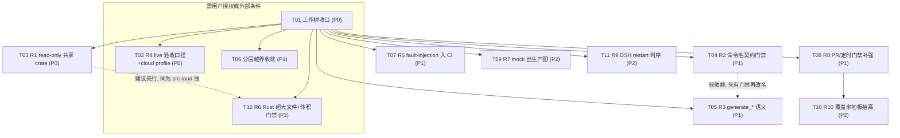

# AI Novel Studio v3.7.0 — 可执行改进任务清单

> 编制日期：2026-09-10
> 输入：`reports/project-assessment-2026-09-10.md`（综合评级 B）
> 编制角色：架构师（高见远）
> 性质：**只读产出**。本清单是评估结论的落地拆解，**不构成下一版本开发授权**；其中涉及 Git 写操作、真实凭据/预算、破坏性范围扩大的任务，均标注为「需用户授权」。
> 落点核实：下列所有路径与行号均由本次实际 `Read` / `Grep` / `Glob` 到仓库核对；与原始评估报告不一致处已标注 **【修正】**。

---

## 0. 先读：本次核实对评估报告的修正与补充

| 报告原文 | 本次核实结果 | 处理 |
| --- | --- | --- |
| R3 落点 `src-tauri/src/dsh/task_runtime.rs:47-56` | **【修正】** 实际路径为 `src-tauri/src/services/dsh/task_runtime.rs`（4311 行）；第 47–57 行为 `ALLOWED_TOOLS` / `CANONICAL_ALLOWED_TOOLS` / `CHAPTER_WRITE_ALLOWED_TOOLS` / `CANDIDATE_TOOLS`，内容与报告相符 | 以修正路径为准 |
| 补充项 `conversation_repository.rs`（报告未给全路径） | **【修正】** 实际路径为 `src-tauri/src/repositories/conversation_repository.rs`（4693 行） | 以修正路径为准 |
| R1 `gateway/src/tools.rs:1-13` | 核实正确：漂移风险自述在第 8–13 行 | 无需修正 |
| R6 行数 5157 / 4936 / 1834 / 1418 / 1246 | 全部逐字核实正确 | 无需修正 |
| R2「TS 侧约 167 个命令字符串字面量」 | 核实为 `dbCall<T>('cmd')` 形式 **167 处**、去重 **158 个**命令名；Rust 侧 `#[tauri::command]` 分布于 **33 个** `.rs` 文件，单一注册点在 `src-tauri/src/main.rs:228` | 数字精确化 |
| — | **补充**：R1 已有部分缓解——`src-tauri/gateway/src/sql_column_contract.rs`（81 行）是**列名漂移守卫**（test-only，`include_str!` 比对 gateway `tools.rs` 与 app 各 repository），其文件头自述「does not unify queries or extract a crate」。即：目前防的是**列名**，未防**读语义** | 影响 T03 设计 |
| — | **补充**：R2/R3/R5 所在仓库**没有**任何 bindings 生成脚本（`scripts/` 下无相关脚本） | 影响 T04 设计 |
| 工作树 | 实测 23 个已修改文件、6 个未跟踪新文件（+ 评估报告自身 1 个未跟踪）；`codex/v3.7.0-writing-subagent` **领先 `origin` 8 个提交** | 与报告一致 |

---

## 1. 任务总览表

| 任务 | 标题 | 优先级 | 依赖 | 建议顺序 | "可立即做 / 需条件" | 工作量 |
| --- | --- | --- | --- | --- | --- | --- |
| **T01** | 工作树收口（提交在途能力 + 推送 + 产物归档决策） | **P0** | 无 | 第 1 步 | 需用户授权（Git 写操作） | S |
| **T02** | R4 live 云端只读验收：口径固定 + cloud profile 实现 +（授权后）脱敏执行 | **P0** | T01 | 第 2 步 | 前半可立即做；**验收需用户授权**（真实凭据+预算） | M |
| **T03** | R1 抽 read-only 共享 crate，消除 Gateway SQL 复刻 | **P0** | T01 | 第 3 步 | 可立即做（高风险，需读语义回归） | L |
| **T04** | R2 命令名编译期契约（清单门禁生成 + CI 接入） | **P1** | T01 | 第 4 步 | 可立即做 | M |
| **T05** | R3 `generate_*` 语义重命名 + 兼容别名 | **P1** | T01（软依赖 T04） | 第 5 步 | 可立即做 | M |
| **T06** | 分层越界收敛：`useWorkbenchTaskRunner` 编排下沉 + 3 组件去直连 AI 客户端 | **P1** | T01 | 第 6 步 | 需先确认范围授权 | L |
| **T07** | R5 `fault-injection` 回环验收加入定时 CI | **P1** | T01 | 第 7 步 | 可立即做 | S |
| **T08** | R8 补定时全量 Rust + PR 覆盖率门禁 | **P1** | T01 | 第 8 步 | 可立即做 | M |
| **T09** | R7 `mockAiClient` 移出生产依赖图 | **P2** | T01 | 第 9 步 | 可立即做 | S |
| **T10** | R10 覆盖率地板单调抬升并纳入 PR | **P2** | T08 | 第 10 步 | 可立即做 | S |
| **T11** | R9 消除 GAP-17 DSH restart 测试时序依赖 | **P2** | T01 | 第 11 步 | 可立即做 | M |
| **T12** | R6-Rust 超大文件（`project_backup` / `structured_artifact_apply_service`）分层抽离 + Rust 体积门禁 | **P2** | T01（T03 建议先行） | 第 12 步 | 需先确认范围授权（涉数据安全） | L |

**并行性说明**：T03–T12 之间除 T05↔T04、T10↔T08 两条软/硬依赖外**互相独立**，在 T01 收口后可多工程师并行（建议按 `src-tauri`（T03/T05/T11/T12）与 `src/` 前端（T06/T09）两条线分工，T04/T07/T08/T10 属 CI/质量线）。

---

## 2. 任务展开卡片

### T01 — 工作树收口（P0 · 前置清理）

**优先级**：P0 ｜ **依赖**：无 ｜ **顺序**：第 1 步 ｜ **工作量**：S ｜ **性质**：⚠️ 需用户授权（Git 写操作）

**精确文件落点**（`git status --short` 实测）：
- 已修改 23 个：
  `.github/workflows/release.yml`、`AGENTS.md`、`CHANGELOG.md`、`README.md`、`docs/agent-workflow.md`、`docs/technical/desktop-build.md`、`docs/technical/testing.md`、`docs/user/ai-settings.md`、`package.json`、`scripts/quality/check-component-size.mjs`、`src-tauri/src/ai.rs`、`src-tauri/src/main.rs`、`src/components/settings/AiApiModelEditor.tsx`、`src/components/settings/AiProviderSettingsCard.tsx`、`src/components/settings/AiSavedApiModelCards.tsx`、`src/components/settings/apiModelEditorDraft.ts`、`src/pages/Settings/settingsNavigation.test.tsx`、`src/services/ai/aiSettingsService.ts`、`src/services/ai/aiSettingsStore.test.ts`、`src/services/ai/aiSettingsStore.ts`、`src/services/ai/savedApiModels.ts`、`src/styles/theme.css`、`src/types/ai.ts`
- 未跟踪 6 个（+ 本清单/评估报告）：
  `src/services/ai/cloudModelCatalog.ts`、`src/services/ai/cloudModelCatalog.test.ts`、`src/services/ai/savedApiSources.ts`、`src/services/ai/savedApiSources.test.ts`、`src/components/settings/AiApiSourceModelCatalog.tsx`、`.cursor/rules/update-release-exe.mdc`
  （另有 `reports/project-assessment-2026-09-10.md` 与本文件 `reports/execution-checklist-2026-09-10.md` 同属未跟踪）
- 未推送提交 8 个（`git log --oneline -8`，HEAD=`cd2599b docs: align v3.7.0 writing-path facts and record remaining gaps`）

**具体要做什么**：
1. 与用户确认在途能力「设置页 API 模型按来源分组」是否为**可交付的完整切片**；若是，按 `AGENTS.md §7.3–7.4` 只暂存本切片相关文件（对比 `git diff` 排除无关项），**不使用 `git add .`**。
2. 对该切片先补验证：`npm run verify:change -- --base origin/codex/v3.7.0-writing-subagent`（含 `npx tsc --noEmit`、相关行为测试、`test:component-size`、`test:ownership`）。`package.json`、`scripts/quality/check-component-size.mjs` 的既有改动属质量线，需单独成 commit。
3. 决策 `reports/*.md` 与 `.cursor/rules/update-release-exe.mdc` 的去向（提交 / 保留未跟踪 / 加入 `.gitignore`）——**由用户决定**。
4. 收口后推送：`git push origin codex/v3.7.0-writing-subagent`（**仅获授权后**）。
5. 本地 EXE 重建（`AGENTS.md §7.6`）：`Remove-Item Env:CARGO_TARGET_DIR -ErrorAction SilentlyContinue; npm run dsh:assets; npx tauri build --bundles none`。

**验收标准**：
```powershell
git status --short --branch     # 期望："## codex/v3.7.0-writing-subagent...origin/..." 无 [ahead N]
git log --oneline origin/codex/v3.7.0-writing-subagent..HEAD   # 期望：空
npm run verify:change -- --base origin/codex/v3.7.0-writing-subagent   # 期望：退出码 0
git diff --check                # 期望：无输出
```
产物：`src-tauri/target/release/AI Novel Studio.exe` 可打开（用户可运行验证）。

**风险与回滚**：① 误将用户未完成改动混入提交 → 回滚 `git reset --soft HEAD~1` 后重挑文件；② 推送后无法简单回退 → 推送前先在本地核对 `git show --stat`；③ EXE 被占用 → 停止覆盖并报告路径，请用户先退出（`AGENTS.md §7.6`）。

---

### T02 — R4 live 云端只读验收：口径固定 + cloud profile 实现 +（授权后）脱敏执行（P0）

**优先级**：P0 ｜ **依赖**：T01 ｜ **顺序**：第 2 步 ｜ **工作量**：M ｜ **性质**：前半可立即做；**验收执行需用户授权**（真实云端凭据 + 预算）

**精确文件落点**：
- `scripts/dsh/test-agent-runtime-real.mjs`（head 1–40 行实测：非回环 URL **fail closed**，`DSH_E2E_BASE_URL` 未设时打印 `NOT_RUN` 退出 0；非回环仅当 `DSH_E2E_FORCE_CLOUD=1` 时退出 2，**cloud profile 执行路径未实现**）
- `package.json:20`（`test:agent-runtime:real` script）
- `docs/architecture/conversational-creative-workbench.md:618-628`（§14.5，**验收标准权威定义**）
- `docs/feature-gap-analysis-v3.7.0.md:63`（§4 R4 条目）

**具体要做什么**：
1. **口径固定（可立即做，纯文档）**：在 `docs/architecture/conversational-creative-workbench.md §14.5` 与 `docs/feature-gap-analysis-v3.7.0.md §4/§5` 明确：R4 的仓内 loopback 闭环 ≠ live 云端验收；未经 live 执行**永不得写 VERIFIED**；live 结论只以 §14.5 四条判定标准（凭据 opt-in / `DSH_E2E_BASE_URL` + cloud profile / 通过条件 / 脱敏证据）为准。
2. **cloud profile 执行路径实现（可立即做，代码）**：在 `scripts/dsh/test-agent-runtime-real.mjs` 中实现 §14.5 第 2 条所述的 cloud profile 执行分支（当前缺失）；保持失败关闭与脱敏（仅留存工具名/计数/状态码/内容 hash，参考 `scripts/e2e/artifact-sanitizer.ts:1-45`），默认 CI 与 `npm test` 不运行、不需要任何 Key。
3. **live 执行（需授权）**：用户提供真实远程模型凭据并授权预算后，设置 `DSH_E2E_BASE_URL` 与 cloud profile，运行 `npm run test:agent-runtime:real`，按 §14.5 通过条件判定，留存脱敏证据。

**验收标准**：
```powershell
# 口径 + 实现（无需凭据）
node scripts/dsh/test-agent-runtime-real.mjs        # 期望：输出 "NOT_RUN: DSH_E2E_BASE_URL is not set"，退出 0
npm run test:docs-sync                              # 期望：退出码 0（文档口径改动需过此门）
# live 执行（需授权，另附证据）
$env:DSH_E2E_BASE_URL="<真实 endpoint>"; npm run test:agent-runtime:real   # 期望：真实模型只读回合仅调 canonical 四工具，零 result_artifacts，字数不变
```
「通过条件」严格按 §14.5 第 3 条：模型自主调用 `novel.read / structure.read / context.read / memory.search`，**不调用** `generate_chapter` 与 legacy 只读别名，零 `result_artifacts`、零产物卡片、零采用草稿、章节字数不变。

**风险与回滚**：① 误把 Mock/loopback 写成 VERIFIED → 以 §14.5 为准，文档改动必须过 `test:docs-sync`（`check-capability-docs.mjs` 能拦虚假 live 声明）；② live 执行产生未脱敏证据 → 复用既有 sanitizer，不新增打印；③ cloud 分支实现引入默认网络访问 → 保持 `DSH_E2E_BASE_URL` 未设即 `NOT_RUN` 退出的不变量。回滚：文档改动 `git checkout -- <doc>`；代码改动 revert 单文件。

---

### T03 — R1 抽 read-only 共享 crate，消除 Gateway SQL 复刻（P0）

**优先级**：P0 ｜ **依赖**：T01 ｜ **顺序**：第 3 步 ｜ **工作量**：L ｜ **性质**：可立即做（高风险，需读语义回归）

**精确文件落点**：
- `src-tauri/gateway/src/tools.rs`（**6316 行**；漂移自述在第 **8–13** 行："SQL and column semantics mirror the app's Rust schema… v3.2 should extract a shared read-only crate to remove the SQL drift risk"）
- `src-tauri/gateway/src/sql_column_contract.rs`（**81 行**；现有 test-only 列名守卫，头注自述 "This does not unify queries or extract a crate"）
- `src-tauri/gateway/Cargo.toml`（crate 名 `novel-domain-gateway`）
- 被复刻的对端：`src-tauri/src/db.rs`、`src-tauri/src/repositories/*.rs`（`novel_repository.rs` / `world_setting_repository.rs` / `chapter_repository.rs` / `chapter_engineering_repository.rs` / `character_state_repository.rs` / `style_profile_repository.rs` / `large_text_repository.rs`）、`src-tauri/src/services/memory_service.rs`（以上均被 `sql_column_contract.rs` 以 `include_str!` 引用）
- 注册点：`src-tauri/Cargo.toml`（workspace/成员）、`src-tauri/gateway/src/main.rs`

**具体要做什么**：
1. 新建 read-only 共享 crate（建议 `src-tauri/domain-read/`，仅依赖 `rusqlite`，**无写操作、无 migration**），把 gateway `tools.rs` 中与 app repository 重叠的只读查询与列语义迁入，作为**唯一真相源**。
2. 让 `gateway/src/tools.rs` 与 app 侧只读路径共同依赖该 crate；逐步删除 `tools.rs` 内的复刻 SQL。
3. 保留并扩展 `sql_column_contract.rs` 为「读语义契约测试」：除列名外，对每张被读表的 **filter / 投影字段 / order 语义**做断言（注意其头注说明 filter/LIMIT/ORDER BY 有意不同者需显式豁免）。
4. 按 `AGENTS.md §6`「Migration/共享持久化/DSH」：改共享持久化读语义需跑对应完整 Rust 领域检查 + 真实 SQLite/桌面场景。

**验收标准**：
```powershell
cargo check --locked --manifest-path src-tauri/Cargo.toml        # 期望：退出码 0
cargo test --locked --manifest-path src-tauri/Cargo.toml -p novel-domain-gateway -- --test-threads=1
cargo test --locked --manifest-path src-tauri/Cargo.toml -- --test-threads=1   # 期望：通过
npm run test:canonical-manifest    # 期望：退出码 0（canonical 只读链路未受影响）
```
（`cargo test -p novel-domain-gateway` 的包名与测试过滤需核实。）

**风险与回滚**：① 抽 crate 改变读语义 → **最大风险**，必须在动 SQL 前先写「读语义契约测试」锁定当前行为；② gateway 与 app 的 filter/LIMIT/ORDER BY 有意差异被强行统一 → 用显式豁免表；③ workspace 依赖变更导致 CI 全矩阵回归 → 单独提交、单独验证。回滚：新增 crate 可整体删除，`tools.rs` 改动 revert 单文件即可恢复（因未改 schema/migration，无数据风险）。

---

### T04 — R2 命令名编译期契约（P1）

**优先级**：P1 ｜ **依赖**：T01 ｜ **顺序**：第 4 步 ｜ **工作量**：M ｜ **性质**：可立即做

**精确文件落点**：
- Rust 侧单一注册点：`src-tauri/src/main.rs:228`（`.invoke_handler(generate_app_handler![...])`，宏定义在 `main.rs:28-44`；命令列表自 228 行起 100+ 项）；`#[tauri::command]` 分布于 **33 个** `.rs` 文件
- TS 侧调用入口：`src/services/database/db.ts:97`（`export async function dbCall<T>(...)`）；命令名以**字符串字面量**形式出现 **167 处**（去重 158 个），另有少数 `invoke('...')`（如 `src/services/tauri/e2eBridge.ts:69,133`）
- 已有近似设施可复用：`scripts/quality/check-capability-docs.mjs`、`scripts/dsh/canonical-tool-manifest-contract.test.mjs:49-102`
- **新门禁脚本**：`scripts/quality/check-command-contract.mjs`（新增）+ `package.json` scripts 段（新增 `test:command-contract`）+ `.github/workflows/ci.yml` / `windows-desktop-e2e.yml` 接入

**具体要做什么**：
1. 新增 `scripts/quality/check-command-contract.mjs`：从 `src-tauri/src/main.rs` 的 `generate_app_handler![...]` 解析出**已注册命令清单**，与 `src/` 中 `dbCall('...')` / `invoke('...')` 的字符串字面量集合做双向漂移比对（TS 引用了未注册命令 → FAIL；Rust 注册但无引用 → WARN，允许 e2e-only 白名单）。
2. 生成并提交一份 `contracts/agent/tauri-command-manifest.v1.json`（或等价 artifact）作为可比对基线；参考 `canonical-tool-manifest` 的 hash 校验模式。
3. 在 `package.json` 增加 `test:command-contract`，接入 `verify:change`（`scripts/quality/verification-scopes.mjs` 增加 `src-tauri/**` 与 `src/services/database/**` 的映射）与 PR lane。
4. 不重命名任何现有命令（改名属 T05/独立变更），本次只建**门禁**。

**验收标准**：
```powershell
node scripts/quality/check-command-contract.mjs     # 期望：退出码 0，打印 "matched N commands"
npm run test:command-contract                       # 期望：退出码 0
npm run verify:change -- --dry-run                  # 期望：改动 src-tauri/src/main.rs 时选中 command-contract
npm run test:ownership                              # 期望：新门禁的行为归属已登记，退出码 0
```
负向样本：故意把某 `dbCall('get_all_novels')` 改为 `dbCall('get_all_novels_typo')`，期望门禁 FAIL。

**风险与回滚**：① 解析 Rust 宏列表脆弱 → 用 `--report` 输出未匹配项人工复核；② 把 e2e-only 命令误判为孤儿 → 白名单机制；③ 门禁进入 PR 后误伤既有分支 → 首次接入先以 WARN 模式合并，稳定后转 FAIL。回滚：脚本与 `package.json` 条目可整体删除，不改动业务代码。

---

### T05 — R3 `generate_*` 语义重命名 + 兼容别名（P1）

**优先级**：P1 ｜ **依赖**：T01（软依赖 T04：契约门禁先就位再改名） ｜ **顺序**：第 5 步 ｜ **工作量**：M ｜ **性质**：可立即做

**精确文件落点** **【修正路径】**：
- `src-tauri/src/services/dsh/task_runtime.rs:47-57` —— `ALLOWED_TOOLS`（含 `generate_chapter,generate_outline,...`）、`CANONICAL_ALLOWED_TOOLS`、`CHAPTER_WRITE_ALLOWED_TOOLS`（第 52–53 行）、`CHAPTER_POLISH_ALLOWED_TOOLS`、`CANDIDATE_TOOLS`（第 56–57 行）
- 契约/清单：`contracts/agent/canonical-tool-manifest.v1.json`、`src/services/capabilities/canonical/canonicalToolManifest.ts`、`src-tauri/src/services/dsh/canonical_manifest.rs:20`
- 交叉校验：`scripts/quality/check-capability-docs.mjs`、`scripts/dsh/canonical-tool-manifest-contract.test.mjs:49-102`
- 文档口径：`docs/feature-gap-analysis-v3.7.0.md:68`（§4 P1 GAP-02）、`docs/audit-v2/agent_gap_report.md:41`

**具体要做什么**：
1. 为语义相反的 `generate_*` 工具引入**描述性候选名**（如 `propose_chapter` / `propose_outline` 之类，最终命名由用户在评审中确认），在模型中暴露新名，同时保留 `generate_*` 为**兼容别名**并标注 deprecated。
2. 同步更新三处并行清单（TS Canonical manifest / DSH allowlist / Gateway exposure）与 `contracts/` 共享 artifact；更新后必须重算 hash（**禁止**为绕过门禁仅改 hash 或 exposure，见 `AGENTS.md §5`）。
3. 更新权威文档口径（§14.5 工具名、Writing SubAgent 契约）与 `CHANGELOG.md`。

**验收标准**：
```powershell
npm run test:canonical-manifest     # 期望：退出码 0（TS + Rust + Node 三方 hash 一致）
npm run test:docs-sync              # 期望：退出码 0
cargo test --locked --manifest-path src-tauri/Cargo.toml -p ai-novel-studio canonical_manifest -- --test-threads=1   # 期望：通过
```
兼容性：旧 `generate_*` 名仍可解析（别名测试）。

**风险与回滚**：① 改工具名会动 DSH allowlist 与模型可见集合 → 必须先过 `test:canonical-manifest` 再合并；② 误改 hash 绕过门禁 → 由 `canonical-tool-manifest-contract.test.mjs` 独立复核拦截；③ 破坏性重命名无迁移 → 全程保留兼容别名，分两步（先加新名，后删旧名）提交。回滚：revert 对应 commit，恢复旧 allowlist。

---

### T06 — 分层越界收敛：编排下沉 + 去组件直连 AI 客户端（P1）

**优先级**：P1 ｜ **依赖**：T01 ｜ **顺序**：第 6 步 ｜ **工作量**：L ｜ **性质**：需先确认范围授权（`AGENTS.md §4` 禁止大规模重构）

**精确文件落点**（全部实测）：
- `src/pages/Workbench/hooks/useWorkbenchTaskRunner.ts`（**1834 行**，受 `check-component-size.mjs` 冻结预算限制，**只可缩不可涨**）；实测导入 **17 个** services（`grep -n "from '../../../services/"`，第 8/9/13/14/15/20/27/32/36/37/38/43/47/48/52/56/57 行），承担 `sendMessage` / `generateMissingAsset` / `resumeChapterGoal` / `reconcilePersistedAssetOrchestration`
- 3 个直连 AI 客户端的组件（实测 `grep -rln "createAiClient|createProviderAdapter|new MockAiClient|new RealAiClient" src/components/` 恰为这 3 个）：
  - `src/components/outline/OutlineEditor.tsx:13`（`import { createAiClient, aiSettingsService } from '../../services/ai/aiClient'`）
  - `src/components/right-dock/panels/AiGeneratePanel.tsx:4`（同上，`../../../services/ai/aiClient`）
  - `src/components/settings/AiGatewaySettingsCard.tsx:5,8`（`validateGatewayConfig` from `realAiClient` + `createProviderAdapter` from `providerAdapter`）
- 边界规则：`AGENTS.md §5`（pages 不放复杂业务编排；components 不直接 AI/数据库调用）
- 门禁：`scripts/quality/check-component-size.mjs:13-15`（`LEGACY_TS_BASELINE` 含 `useWorkbenchTaskRunner.ts:1834`、`qualityFixService.ts:1418`、`mockAiClient.ts:1246`）

**具体要做什么**：
1. **先向用户确认拆分范围**（`AGENTS.md §4`：不顺手重构）。获批后：把 `useWorkbenchTaskRunner.ts` 内的回合编排（send / 资产生成 / 章节目标恢复 / 资产编排对齐）按职责下沉到 `src/features/workbench/` 或 `src/services/conversation/` 的既有 orchestration 模块，hook 只保留 React 订阅与调用编排层。
2. 3 个组件改为调用 `src/services/ai/` 的门面（如既有 `aiTaskService`），删除组件内 `createAiClient` / `createProviderAdapter` 直接构造。
3. 若 `useWorkbenchTaskRunner.ts` 或 `qualityFixService.ts` 降到预算内，**必须**从 `LEGACY_TS_BASELINE` 删除对应条目（否则 `staleBaseline` 校验 FAIL，见 `check-component-size.mjs:83,120`）。
4. 每步补/更新相邻行为测试（`src/pages/Workbench/hooks/useWorkbenchTaskRunner.test.tsx` 已存在），并更新 `CHANGELOG.md`。

**验收标准**：
```powershell
npm run test:component-size     # 期望：退出码 0，且文件只缩不涨
npx tsc --noEmit                # 期望：退出码 0
npm run test:workbench          # 期望：退出码 0（工作台行为未回归）
npm run test:ownership          # 期望：退出码 0
npm run verify:change           # 期望：退出码 0
```
边界复核（期望降为 0）：
```powershell
grep -rln "createAiClient\|createProviderAdapter\|new MockAiClient\|new RealAiClient" src/components/   # 期望：空
```

**风险与回滚**：① 闭包重接线引入工作台回归 → **必须**靠 `test:workbench` + `useWorkbenchTaskRunner.test.tsx` 兜底，按 `AGENTS.md §6` 跑桌面真实场景；② 拆分过程中文件临时变大触发体积门禁 → 只在最终态缩减，中间态不提交；③ 与 T09/T05 同改 `src/services/ai/` → 任务线分工避免文件重叠。回滚：按 commit 粒度 revert，保持 T01 的干净基线。

---

### T07 — R5 `fault-injection` 回环验收加入定时 CI（P1）

**优先级**：P1 ｜ **依赖**：T01 ｜ **顺序**：第 7 步 ｜ **工作量**：S ｜ **性质**：可立即做

**精确文件落点**：
- `package.json:63-64`（`test:real-profile:writing-subagent` = `wdio run tests/real-acceptance/wdio.real-profile.conf.ts`；`test:fault-injection:writing-subagent` = `wdio run tests/real-acceptance/wdio.fault-injection.conf.ts`）
- 载体：`tests/real-acceptance/wdio.fault-injection.conf.ts`（1682 B）、`tests/real-acceptance/writing-subagent-fault-injection.spec.ts`（37411 B）、`tests/real-acceptance/production-carrier.ts`、`tests/real-acceptance/production-app-helpers.ts`
- 目标工作流：`.github/workflows/windows-desktop-e2e.yml`（`on.schedule cron: '0 18 * * 1'`，第 7-9 行；`FULL_MATRIX` 定义在第 47 行）
- 实测：`.github/` 全目录**零**处引用 `test:fault-injection` / `test:real-profile`（`grep -rn` 无命中）→ 认证 R5

**具体要做什么**：
1. 在 `windows-desktop-e2e.yml` 的 `schedule`/`workflow_dispatch` 分支新增一个 **fault-injection job**，运行 `npm run test:fault-injection:writing-subagent`。
2. 前提核实：R5 建议只把**回环、零网络**的 fault-injection 纳入（不含需要凭据的 real-profile）；若现有 `wdio.fault-injection.conf.ts` 依赖真实模型，需先将上游替换为回环故障注入桩（对应 `production-carrier.ts`），确保 job 不需要任何 Key。
3. 该 job 只挂 `schedule`（周二）与手动触发，**不阻塞 PR**（保持 PR 快速通道），并在 job 名中显式标注 `loopback, zero-network`。

**验收标准**：
```powershell
# 先在本地/Windows 上手工跑通（确认零网络、零凭据）
npm run test:fault-injection:writing-subagent      # 期望：退出码 0
# CI 结构校验
grep -n "fault-injection" .github/workflows/windows-desktop-e2e.yml   # 期望：job 与 schedule 触发存在
npm run test:docs-sync                             # 期望：退出码 0（若同步更新 testing.md）
```
（本地命令若依赖 Windows 桌面载体，标 **需核实**：需按 `docs/technical/desktop-e2e.md` 准备固定载体。）

**风险与回滚**：① job 实际需要凭据/网络 → 上 CI 前先本地断言无 Key 依赖；② 定时 job 变红无人管 → 输出 artifact + 明确失败分类（`AGENTS.md §6` 证据分级）；③ 拖慢定时矩阵 → 独立 job，与 `quality` job 解耦。回滚：删除该 job 块，工作流其余不变。

---

### T08 — R8 补定时全量 Rust + PR 覆盖率门禁（P1）

**优先级**：P1 ｜ **依赖**：T01 ｜ **顺序**：第 8 步 ｜ **工作量**：M ｜ **性质**：可立即做

**精确文件落点**：
- `.github/workflows/ci.yml:32-37`（PR lane **仅** `node scripts/quality/verify-change.mjs --base ... --lane frontend`；`lint:ci`/`test:coverage`/`build`/`bundle-size` 均 `if: github.event_name != 'pull_request'`）
- `.github/workflows/windows-desktop-e2e.yml:47`（`FULL_MATRIX` 仅 `schedule` / `full*` / `main` push 为真 → **PR 不跑全量 Rust**）；第 175 行 `cargo test --locked --manifest-path src-tauri/Cargo.toml -- --test-threads=1`；第 179 行 `run-cargo-tests.mjs`
- 覆盖率阈值：`package.json:42-44`（全局 lines 34 / statements 34 / functions 44 / branches 64；8 个 core 模块 85）

**具体要做什么**：
1. **定时全量 Rust**：确认 `windows-desktop-e2e.yml` 的 schedule（周二 02:00）已覆盖 `FULL_MATRIX`（第 47 行含 `schedule`）→ 已具备；补齐缺口为「**共享 Rust 模块**的 PR 变更能被选中跑 Rust」：在 `scripts/quality/verification-scopes.mjs` 增加 `src-tauri/**` 的 native lane 行为归属映射，并在 `ci.yml` PR 分支增加 `--lane native`（或让 `windows-desktop-e2e.yml` 的 PR 触发对 `src-tauri/**` 改动启用轻量 Rust check）。
2. **PR 覆盖率门禁**：把 `npm run test:coverage`（`package.json:42`）在 PR 上以**增量阈值**或对**受影响模块**的覆盖率检查接入，避免"约 2/3 代码可无测试通过"溜进 main（与 T10 协同，先建门禁再抬阈值）。
3. 不改 PR 触发条件为全量（保持 PR 快速通道）。

**验收标准**：
```powershell
npm run verify:change -- --dry-run    # 期望：改 src-tauri/** 时展示 native lane 选择理由
npm run test:coverage                 # 期望：退出码 0（Windows 校准工具链）
# PR 语义自检：构造一个仅改 src-tauri 的提交，确认 PR 会选中 Rust 检查
```
（PR lane 具体 job 名与 required checks 需核实平台分支保护配置——`AGENTS.md §6` 说明仓内无法取证桌面 E2E 是否阻塞合并。）

**风险与回滚**：① PR 变慢/频繁红 → 覆盖率门禁先对「受影响模块」而非全仓生效；② 平台分支保护未同步 → 门禁代码与 required checks 需人工配置；③ 与 T10 冲突 → T08 建门禁、T10 抬阈值，串行。回滚：`ci.yml` / `verification-scopes.mjs` 改动 revert 单文件。

---

### T09 — R7 `mockAiClient` 移出生产依赖图（P2）

**优先级**：P2 ｜ **依赖**：T01 ｜ **顺序**：第 9 步 ｜ **工作量**：S ｜ **性质**：可立即做

**精确文件落点**（实测静态导入，已进入 bundle 图）：
- `src/services/ai/aiClient.ts:5`（`import { MockAiClient } from './mockAiClient';`）+ `:58`（`export { MockAiClient } from './mockAiClient';`）
- `src/services/ai/providerAdapter.ts:11`（`import { MockAiClient } from './mockAiClient';`）
- `src/services/tauri/e2eBridge.ts:8`（`} from '../ai/mockAiClient';`）
- 目标模块：`src/services/ai/mockAiClient.ts`（**1246 行**，受 `check-component-size.mjs:15` 冻结预算）
- 包体门禁：`scripts/quality/check-bundle-size.mjs`（`npm run test:bundle-size`）

**具体要做什么**：
1. 将 `mockAiClient` 改为**动态 `import()`**（按 `runtimeMode === 'mock'` 或 e2e 开关惰性加载），或把它拆到独立的、只在 mock / e2e 条件解析的入口，使其不进入默认生产 chunk。
2. `aiClient.ts` 的 `export { MockAiClient }`（:58）评估是否仍有外部依赖方；有则保留 lazy re-export 形态，无则内联。
3. 保持 `runtimeMode === 'mock'` 行为不变（`aiClient.ts:26-27`）；补/更新 `aiCancellation.test.ts:61-62` 等对 mock 模块路径的断言。

**验收标准**：
```powershell
npm run test:bundle-size     # 期望：退出码 0 且生产 bundle 体积下降（记录 before/after）
npx tsc --noEmit             # 期望：退出码 0
npm test                     # 期望：退出码 0（mock 行为未回归）
grep -rn "import.*mockAiClient" src/services/ai/aiClient.ts   # 期望：不再有顶层静态 import
```

**风险与回滚**：① 动态导入在 Vite 下仍可能被预打包 → 以 bundle-size 实测为准；② 误删 mock 导致 `runtimeMode=mock` 失效 → 保留 mock 行为测试；③ e2e 桥接依赖 → `e2eBridge.ts` 属 e2e-only，可保留其静态依赖。回滚：revert `aiClient.ts` / `providerAdapter.ts` 改动。

---

### T10 — R10 覆盖率地板单调抬升并纳入 PR（P2）

**优先级**：P2 ｜ **依赖**：T08 ｜ **顺序**：第 10 步 ｜ **工作量**：S ｜ **性质**：可立即做

**精确文件落点**：
- `package.json:42`（`test:coverage`：`--lines 34 --statements 34 --functions 44 --branches 64`）
- `package.json:43`（`test:coverage:core`：8 个模块 `--lines 85 --statements 85 --functions 80 --branches 80`）
- `package.json:44`（`test:coverage:components`）

**具体要做什么**：
1. 采集当前真实覆盖率（`npm run test:coverage` + `test:coverage:core` + `test:coverage:components`），得到现状基线。
2. 将全局阈值**单调上调**至略低于现状的安全水位（不得下调），并在 `AGENTS.md §6` 或 `docs/technical/testing.md` 记录「阈值只能单调上升」的规则。
3. 依托 T08 已建立的 PR 覆盖率门禁生效。
4. 现状证据：仓库提交 `08106eb chore(coverage): print per-file core coverage...`、`e4efcb7 fix(ci): enforce coverage thresholds only on the calibrated Windows toolchain` 说明跨平台阈值校准已存在，改动须遵守该约束（阈值仅在 Windows 校准工具链强制）。

**验收标准**：
```powershell
npm run test:coverage    # 期望：退出码 0（新阈值下仍通过）
# 记录 before/after 阈值与实测覆盖率百分比
```

**风险与回滚**：① 阈值抬过头导致 CI 常红 → 分多次小步抬升，每次留安全余量；② 跨平台（Linux/Windows）覆盖率差异 → 沿用既有「仅 Windows 校准工具链强制」策略。回滚：把数字改回上一档。

---

### T11 — R9 消除 GAP-17 DSH restart 测试时序依赖（P2）

**优先级**：P2 ｜ **依赖**：T01 ｜ **顺序**：第 11 步 ｜ **工作量**：M ｜ **性质**：可立即做

**精确文件落点**：
- 时序核心：`src-tauri/src/services/dsh/task_runtime.rs`（4311 行）
- 测试载体：`src-tauri/src/services/dsh/task_runtime_tests.rs`（99191 B）、`src-tauri/src/services/dsh/tests.rs`（69911 B）、`src-tauri/src/services/dsh/supervisor.rs`（32510 B）
- 缺口记录：`docs/feature-gap-analysis-v3.7.0.md:79`（§4 P2 GAP-17「完整 Rust 套件并发时 DSH restart 测试有时序敏感性」）
- 串行约束：`AGENTS.md §6`（共享 DSH 状态测试与完整 Rust 验收用 `--test-threads=1`）；`.github/workflows/windows-desktop-e2e.yml:175` 已用串行

**具体要做什么**：
1. 定位 restart 相关测试中依赖真实时序（sleep / 竞态窗口 / 进程启动顺序）的断言。
2. 改为**事件驱动同步**（等待显式信号/状态轮询 + 超时）替代隐式时间等待，消除并发下的非确定性。
3. 目标：使该测试在默认并发（不加 `--test-threads=1`）下也稳定，从而可放开对全局串行的依赖（**不承诺**移除全局串行，只消除该用例的时序敏感）。
4. 更新缺口文档 §4（若关闭 GAP-17 需在 `docs/feature-gap-analysis-v3.7.0.md` 与 `docs/audit-v2/agent_gap_report.md:3` 的校正头同步，且过 `test:docs-sync`）。

**验收标准**：
```powershell
# 并发下反复运行目标测试（例如 20 次）期望全绿
cargo test --locked --manifest-path src-tauri/Cargo.toml -p ai-novel-studio <restart_filter> 2>&1
# 完整串行套件仍全绿
cargo test --locked --manifest-path src-tauri/Cargo.toml -- --test-threads=1   # 期望：通过
```
（`<restart_filter>` 具体测试名 **需核实**。）

**风险与回滚**：① 把真实竞态改成"假绿"（放宽断言）→ **禁止**，`AGENTS.md §6`：不放宽门禁；② DSH 时序核心改动波及启动链 → 改测试为主、谨慎动 `task_runtime.rs` 生产代码；③ 与其他 `src-tauri` 任务（T03/T12）文件重叠 → 排期错开。回滚：测试文件 revert。

---

### T12 — R6-Rust 超大文件分层抽离 + Rust 体积门禁（P2）

**优先级**：P2 ｜ **依赖**：T01（建议 T03 先行，同为 `src-tauri` 线） ｜ **顺序**：第 12 步 ｜ **工作量**：L ｜ **性质**：需先确认范围授权（涉数据安全）

**精确文件落点**（实测行数）：
- `src-tauri/src/project_backup.rs`（**5157 行**）——备份/恢复
- `src-tauri/src/services/structured_artifact_apply_service.rs`（**4936 行**）——产物应用/事务/CAS，**失败关闭核心，谨慎拆**
- 同属超大但**不建议本次动**：`src-tauri/src/migrations.rs`（4546）、`src-tauri/src/repositories/conversation_repository.rs`（4693，**【修正】**报告写作 `src-tauri/src/conversation_repository.rs`）、`src-tauri/src/services/dsh/task_runtime.rs`（4311）、`src-tauri/src/commands.rs`（3789）
- 现有体积门禁：`scripts/quality/check-component-size.mjs` **仅覆盖生产 `.ts`/`.tsx`（`MAX_PRODUCTION_LINES=500` + `LEGACY_TS_BASELINE`），完全不覆盖 Rust** → 需新增 Rust 侧门禁

**具体要做什么**：
1. **先建 Rust 体积门禁**（低风险、可独立交付）：新增 `scripts/quality/check-rust-file-size.mjs`（或扩展现有脚本），对 `src-tauri/src/**/*.rs`（排除 `*_tests.rs`/`tests.rs`）设冻结基线，规则同 TS：**只可缩不可涨**；接入 `verify:change` 与 `.github/workflows/ci.yml`。
2. **`project_backup.rs` 分层抽离**（按备份/恢复/迁移兼容性/校验与序列化拆子模块），全程保留 `AGENTS.md §4` 的 revision/CAS/事务/幂等/失败关闭语义；每步跑 `test:project-backup`（`package.json:56` → `runtime_check_project_backup.ps1`）。
3. **`structured_artifact_apply_service.rs` 谨慎拆**：仅在 T01 干净基线上、且有充分契约测试后动；优先抽离**纯函数**（草稿应用校验、派生计算），不触碰事务/CAS 边界。
4. 每步更新 `CHANGELOG.md`；按 `AGENTS.md §6`「Rust/SQLite」跑 `cargo check --locked` + 相关动态测试 + 真实 SQLite 场景。

**验收标准**：
```powershell
cargo check --locked --manifest-path src-tauri/Cargo.toml        # 期望：退出码 0
cargo test --locked --manifest-path src-tauri/Cargo.toml -- --test-threads=1   # 期望：通过
npm run test:project-backup    # 期望：退出码 0（备份/恢复未回归）
node scripts/quality/check-rust-file-size.mjs   # 期望：退出码 0；被拆文件只缩不涨
npm run verify:change          # 期望：退出码 0
```

**风险与回滚**：① 拆 `structured_artifact_apply_service.rs` 破坏失败关闭 → **数据风险**，原则「宁可少拆，不可拆错」，只抽纯函数；② 备份/恢复行为漂移 → `test:project-backup` + 备份 schema 兼容性必须全绿；③ 一次性重排文件触发大范围 diff → 按子模块小步提交，每步可独立 revert。回滚：按 commit revert，未改 migration/schema，无不可逆数据变更。

---

## 3. 跨任务共享知识（供执行工程师）

1. **每个任务收尾都要重建本地 EXE**（`AGENTS.md §7.6`）：`Remove-Item Env:CARGO_TARGET_DIR -ErrorAction SilentlyContinue; npm run dsh:assets; npx tauri build --bundles none`，产物必须是仓库内 `src-tauri/target/release/AI Novel Studio.exe`。纯文档且不改可执行行为者，在汇报中说明未重建及原因。
2. **验证入口统一**：日常 `npm run verify:change`（可加 `-- --dry-run` 看选择理由）。纯文档 → `npm run test:docs-sync`（+ 涉及版本/路线时 `npm run test:version-sync`）+ `npx prettier --check <改动文件>` + `git diff --check`。前端 → 相邻行为测试 + 改动文件 ESLint + 一次 `npx tsc --noEmit`。Rust → `cargo check --locked` + 非零匹配证明的相关测试。共享 DSH 状态 → `--test-threads=1`。
3. **契约漂移门禁**：`contracts/agent/canonical-tool-manifest.v1.json` 为 TS/Rust 共享 artifact；`npm run test:canonical-manifest` 做 hash + Catalog/bindings/IDS 漂移校验。**禁止**为绕过门禁改 hash 或 exposure（`AGENTS.md §5`）。
4. **体积预算**：`LEGACY_TS_BASELINE`（`scripts/quality/check-component-size.mjs:13+`）中的文件**只可缩不可涨**；降到 500 行内必须删除其条目，否则 `staleBaseline` FAIL。
5. **测试归属**：新增脚本/测试须在 `test-ownership` / `verification-scopes` 登记行为归属，否则 `npm run verify:change` 记 FAIL（`AGENTS.md §6`：未知范围/零测试不能被当作通过）。
6. **证据分级**：Mock / loopback / 浏览器 / 真实桌面 / live Provider 必须**分别标注**；`NOT_RUN`、跳过不得写成通过；真实云端调用需明确授权与可用凭据。
7. **Git 纪律**：commit/push/PR/tag 仅在获授权时执行；只暂存本次相关文件，不用 `git add .`；不直接提交 `main`、不 force push。
8. **安全底线（`AGENTS.md §4`）**：不得提交 API Key / 凭据 / `.env.local` / 用户正文 / 正式库；正式写入保留 revision/CAS/事务/幂等，冲突失败关闭。

---

## 4. 任务依赖图



---

## 5. 明确不宣称 / 边界

- 本清单**不授权**任何下一版本开发；每项实施前需用户按 `AGENTS.md §1/§4` 明确批准。
- 不宣称 R4 已 VERIFIED：T02 的 live 执行部分是**条件项**，未获凭据与预算授权前不得产生 VERIFIED 结论。
- 不扩展范围：只覆盖评估报告已列出的 R1–R10、分层越界与工作树收口，不发明新功能。
- 对命令/脚本名不确定处已就地标注「需核实」（如 gateway 包名、restart 测试具体过滤名、PR required checks 平台配置）。
- 桌面 E2E 是否阻塞合并取决于平台分支保护，仓内无法取证（与报告一致）。
